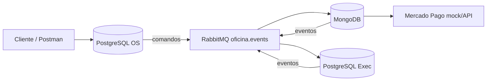

# FIAP Pós Tech — Fase 4 (Microsserviços + Saga)

Hub de orquestração local da Fase 4. Os microsserviços vivem em **repositórios irmãos** (obrigatório do desafio).

| Serviço | Repositório | Porta | Banco |
|---------|-------------|-------|-------|
| **OS Service** (orquestrador Saga) | `Fiap-Pos-Tech-Challenge-os-service` | 8081 | PostgreSQL (SQL) |
| **Billing Service** (orçamento + Mercado Pago) | `Fiap-Pos-Tech-Challenge-billing-service` | 8082 | MongoDB (NoSQL) |
| **Execution Service** (fila de produção) | `Fiap-Pos-Tech-Challenge-execution-service` | 8083 | PostgreSQL (SQL) |

Mensageria compartilhada: **RabbitMQ** (exchange topic `oficina.events`).

## Arquitetura



## Saga Pattern — Orquestração (escolha e justificativa)

Foi adotado o **Saga Orquestrado**, com o **OS Service** como orquestrador central.

**Por quê orquestração (e não coreografia pura)?**
1. O fluxo da OS é linear e crítico: criar → orçar → aprovar → pagar → executar → finalizar.
2. Compensações precisam ser decididas em um único lugar (evitar “pingue-pongue” de eventos entre 3 serviços).
3. Facilita auditoria: tabela `saga_instance` guarda passo atual e status (`RUNNING`, `COMPENSATING`, `COMPENSATED`, `COMPLETED`).
4. Em escala nacional com múltiplas filiais, um orquestrador explícito reduz ambiguidade operacional.

### Fluxo feliz

1. `POST /api/ordens-servico` no OS → status `AGUARDANDO_ORCAMENTO` → publica `orcamento.gerar`
2. Billing gera orçamento (Mongo) → publica `orcamento.gerado` → OS vai para `AGUARDANDO_APROVACAO`
3. Cliente aprova: `POST /api/ordens-servico/{id}/aprovar-orcamento` `{ "aprovado": true }` → OS publica `pagamento.solicitar`
4. Billing cria checkout Mercado Pago (mock auto-aprova) → `pagamento.aprovado` → OS publica `execucao.iniciar` (`EM_EXECUCAO`)
5. Execution entra na fila → oficina avança diagnóstico/reparo → `POST .../finalizar` → `execucao.finalizada`
6. OS finaliza a OS (`FINALIZADA`) → opcional `POST .../entregar` (`ENTREGUE`)

### Compensação

- Rejeição de orçamento ou `pagamento.falhou` → OS marca `FALHA_COMPENSADA` e publica `compensar.orcamento` / `compensar.pagamento` / `compensar.execucao`
- Billing cancela orçamento/pagamento; Execution cancela o job

## Subir tudo (Docker)

Na pasta deste hub:

```bash
docker compose up --build
```

| Recurso | URL |
|---------|-----|
| OS Swagger | http://localhost:8081/swagger-ui.html |
| Billing Swagger | http://localhost:8082/swagger-ui.html |
| Execution Swagger | http://localhost:8083/swagger-ui.html |
| RabbitMQ UI | http://localhost:15672 (guest/guest) |
| Grafana | http://localhost:3000 (admin/admin) |
| Prometheus | http://localhost:9090 |
| Jaeger | http://localhost:16686 |

## Executável de todos os fluxos (recomendado)

Com a stack no ar (`docker compose up --build`):

```powershell
.\run-demo.ps1
# ou
.\run-demo.cmd

# somente happy path / somente compensação / sem inspecionar Docker DBs:
.\run-demo.ps1 --flow=happy
.\run-demo.ps1 --flow=reject
.\run-demo.ps1 --skip-db
```

O JAR `demo-runner/target/fase4-demo-runner.jar`:
1. Exercita o **fluxo feliz** (criar → aprovar → pagar → executar → entregar)
2. Exercita a **compensação** (rejeitar orçamento)
3. Consulta as APIs de cada serviço
4. Faz **snapshot das bases** via Docker (`psql` no Postgres OS/Execution e `mongosh` no Billing)

## Swagger com exemplos

- OS: http://localhost:8081/swagger-ui.html
- Billing: http://localhost:8082/swagger-ui.html
- Execution: http://localhost:8083/swagger-ui.html

Collection Postman unificada: `postman/Fase4-Todos-Fluxos.postman_collection.json`

## CI/CD e qualidade (por repositório)

Cada microsserviço possui:
- `Dockerfile` + manifests `k8s/`
- GitHub Actions: build → testes → JaCoCo (≥80%) → Sonar → imagem → deploy K8s
- Testes unitários + **BDD (Cucumber)** de um fluxo completo
- Collection Postman / Swagger

## Entregáveis do portal

Preencher o PDF com:
1. Nomes dos participantes
2. Links dos 3 repositórios (+ este hub, se publicado)
3. Link do vídeo (≤15 min)
4. Diagrama desta arquitetura
5. Estratégia Saga = **Orquestração** (texto acima)
6. Justificativa da divisão e tecnologias

Roteiro de vídeo sugerido: `docs/ROTEIRO_VIDEO_FASE4.md`

Guia detalhado de funcionamento: `docs/GUIA_COMPLETO_SISTEMAS.md`
